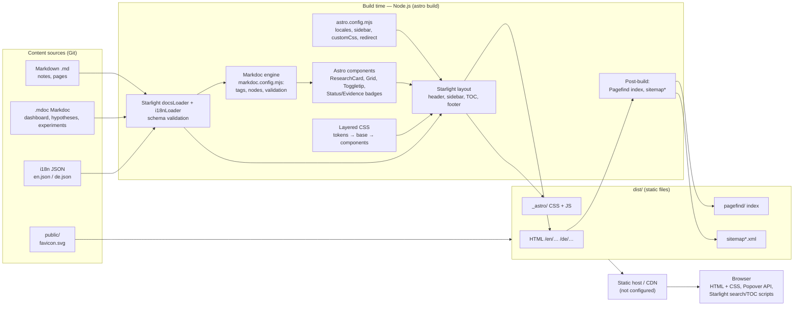
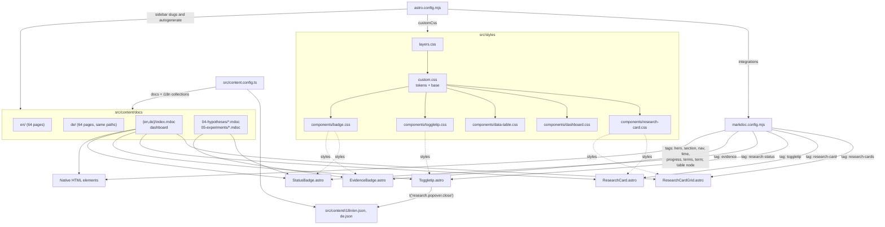

# Project Map — Frontend Architecture for GEO & AEO

Technical overview of the current implementation, for architecture review and knowledge sharing.

- **Inspected:** 2026-11-04
- **Scope:** initial architecture inspection, updated after the technical stabilization review on 2026-11-04. Changes are recorded in `PROJECT_CHANGELOG.md`.
- **Toolchain:** Node.js 24.21.0; pnpm 11.25.0 is the selected package manager.

> **Summary.** This is a **static documentation site**. All content lives as Markdown/Markdoc files in the repository, Astro + Starlight compile it to plain HTML/CSS/JS at build time, and any static file host can serve the `dist/` folder. There is **no backend server, no database, no API and no CMS**.

---

## 1. Project structure

### 1.1 Main directories

| Path | Purpose | Versioned |
|---|---|---|
| `src/content/docs/en/` | English documentation pages (64 files), the default locale | yes |
| `src/content/docs/de/` | German documentation pages (64 files), mirroring `en/` path by path | yes |
| `src/content/i18n/` | Project-specific UI strings (`en.json`, `de.json`) | yes |
| `src/content.config.ts` | Content collection definitions (`docs`, `i18n`) | yes |
| `src/components/` | Astro components rendered by Markdoc tags | yes |
| `src/styles/` | Layered CSS: layer order, tokens, base, and per-component files | yes |
| `public/` | Static files copied unchanged (`favicon.svg`) | yes |
| `.github/` | Copilot repository instructions, a custom agent, and the vendored Google *Modern Web Guidance* skill | yes |
| `astro.config.mjs` | Astro + Starlight configuration | yes |
| `markdoc.config.mjs` | Markdoc nodes, tags, schemas and validation | yes |
| `dist/` | Production build output (generated) | no (`.gitignore`) |
| `.astro/` | Generated content types and cache | no (`.gitignore`) |
| `node_modules/` | Installed dependencies (pnpm layout) | no (`.gitignore`) |

### 1.2 Astro configuration (`astro.config.mjs`)

| Setting | Value | Effect |
|---|---|---|
| `site` | `process.env.SITE_URL` (unset by default) | Absolute canonical URLs, `hreflang` and the sitemap are only produced when `SITE_URL` is set. |
| `output` | not set, so the default `static` | Every route is pre-rendered to HTML. No server adapter is configured. |
| `redirects` | `'/' → '/en/'` | In the static build this becomes `dist/index.html`, a `<meta http-equiv="refresh">` page with `noindex`. It is not an HTTP 301. |
| `integrations` | `markdoc()`, `starlight({...})` | Markdoc must be registered before Starlight. |

### 1.3 Starlight configuration

| Setting | Value |
|---|---|
| `title` | Localized: EN “Frontend Architecture for GEO & AEO”, DE “Frontend-Architektur für GEO & AEO” |
| `description` | One English site description, used as the fallback meta description |
| `defaultLocale` | `en` |
| `locales` | `en` (English), `de` (Deutsch). Both are prefixed, so URLs are `/en/…` and `/de/…`. |
| `customCss` | `layers.css`, `custom.css`, `components/{badge,dashboard,data-table,research-card,toggletip}.css`, in that order |
| `sidebar` | Dashboard plus seven localized groups `01`–`07`. Sections 03 and 07 explicitly list direct page slugs and localized subgroups; subgroup contents and all other sections are autogenerated. Page titles remain localized through Starlight. |

Starlight features in use without extra configuration:

- Pagefind full-text search, including the search `<dialog>`
- Language selector and theme selector
- Right-hand table of contents and mobile TOC
- Previous/next pagination
- Built-in 404 page
- `@astrojs/sitemap`, which Starlight enables automatically when `site` is set

### 1.4 Markdoc configuration (`markdoc.config.mjs`)

The file extends `starlightMarkdoc()`, which adds Starlight's built-in Markdoc tags such as `aside`, `tabs` and `card`, and Expressive Code fences.

**Node overrides**

| Node | Change | Reason |
|---|---|---|
| `document` | `render: null` | Removes Markdoc's default `<article>` wrapper. Starlight's `<main>` already wraps the page, and the extra `<article>` excluded the page `<h1>`. |
| `table` | Adds a `caption` attribute. The transform adds `<caption>`, `scope="col"`, row headers (`<th scope="row">`) and `data-label` on body cells. | Accessible data tables; `data-label` drives the narrow stacked layout. |

**Project tags**

| Tag | Output | Validation |
|---|---|---|
| `hero` | `<header class="research-hero">` | — |
| `section` | `<section>` | — |
| `nav` | `<nav aria-labelledby>` | `labelledby` required |
| `time` | `<time datetime>` (inline) | `datetime` must match `YYYY-MM-DD` |
| `progress` | `<progress value max aria-label>` (inline, self-closing) | all three attributes required; `value`/`max` are numbers |
| `terms` / `term` | `<dl class="research-terms">` with `<dt>`/`<dd>` pairs | `term.name` required; non-`dt`/`dd` children are dropped |
| `toggletip` | `Toggletip.astro` (Popover API) | `id` must match `^[a-z][a-z0-9-]*$`; `label` required |
| `research-cards` | `ResearchCardGrid.astro` | — |
| `research-card` | `ResearchCard.astro` | `title` required. The body must be exactly one block element; otherwise a build error is raised. |
| `evidence` | `EvidenceBadge.astro` | `level` ∈ `A B C D` |
| `research-status` | `StatusBadge.astro` | `value` ∈ `Proposed`, `Under Investigation`, `Supported`, `Rejected`, `Inconclusive` |

Schemas are **language-independent**. German pages keep the canonical value (for example `value="Proposed"`) and pass a translated `label`.

### 1.5 Content structure

The content is organized into these sections:

```
src/content/docs/{en,de}/
├── index.mdoc                  00 Research dashboard
├── 01-foundation/              overview, problem, motivation, objectives, questions, scope,
│                               methodology, approach, literature search protocol, terminology
├── 02-literature/              GEO & AEO, semantics & DOM, rendering & crawling,
│                               structured data, RAG & retrieval, evaluation
├── 03-notes/                   paper/technical/architecture notes, ideas, meetings, journal
│   ├── research-journal/       dated entries (YYYY-MM-DD.md)
│   └── templates/              journal entry template
├── 04-hypotheses/              index + h-001 … h-006 (.mdoc)
├── 05-experiments/             design, test cases/data, environments, metrics, analysis plan,
│                               results, reproducibility, exp-001 … exp-004 (.mdoc)
├── 06-evidence/                key findings, evidence matrix, gaps, contradictions,
│                               limitations, conclusions
└── 07-guidelines/              nine guideline categories
    └── templates/              guideline record template (.mdoc)
```

**Pages and file types**

| | Count |
|---|---|
| Pages per locale | 64 |
| Total source pages | 128 |
| Markdown (`.md`) files | 104 |
| Markdoc (`.mdoc`) files | 24 |

The Markdoc files are 2 dashboards, 12 hypotheses, 8 experiments and 2 templates.

**Research object IDs**

These IDs are identical in both locales:

- Existing records: `H-001`–`H-006` and `EXP-001`–`EXP-004`
- Reserved formats for new records: `PAPER-###`, `HYP-###`, `EXP-###`, `FIND-###` and `FE-###`

### 1.6 Components

All components are server-rendered at build time and ship **no JavaScript**.

| Component | Root element | Props | Used by |
|---|---|---|---|
| `ResearchCard.astro` | `<article class="research-card">` containing `<hgroup>` (h3 + lead) or `<h3>`, then the slot | `title`, `lead?` | `research-card` tag |
| `ResearchCardGrid.astro` | `<section class="research-card-grid">` | — | `research-cards` tag |
| `Toggletip.astro` | `<button popovertarget>` + `<div popover>` with a localized close button | `id`, `label` | `toggletip` tag |
| `StatusBadge.astro` | `<span class="research-badge status-…">` | `value`, `label?` | `research-status` tag |
| `EvidenceBadge.astro` | `<span class="research-badge evidence-…">` | `level`, `label?` | `evidence` tag |

### 1.7 Layouts

The project defines **no custom layouts and no component overrides**. Every page uses Starlight's default page shell:

- `<header>`: site title, search, theme and language selectors
- `<nav>`/`<aside>`: sidebar
- `<main>`: content
- right `<aside>`: table of contents
- `<footer>`: pagination

### 1.8 Styles

CSS is token-driven and ordered with cascade layers:

```css
@layer starlight, research.tokens, research.base, research.components, research.utilities;
```

| File | Layer | Contents |
|---|---|---|
| `layers.css` | — | Declares the layer order above. Starlight's own layers stay lowest. |
| `custom.css` | `research.tokens`, `research.base` | Design tokens (colors, spacing, radius, focus, popover, card sizing; light/dark). Base rules for `:focus-visible`, `caption`, and centred content alongside the TOC. |
| `components/badge.css` | `research.components` | Status and evidence badges |
| `components/dashboard.css` | `research.components` | Hero panel, section spacing, navigation tiles, definition lists |
| `components/data-table.css` | `research.components` | Container query: tables with labelled cells stack into cards below 32rem |
| `components/research-card.css` | `research.components` | Grid + subgrid card layout that aligns heading, lead and body across a row |
| `components/toggletip.css` | `research.components` | Popover trigger and panel. CSS anchor positioning when supported (`@supports`), with UA centring as the fallback. |

### 1.9 Scripts

| Package script | Command | Purpose |
|---|---|---|
| `dev` | `astro dev` | Local dev server with hot reload (default port 4321) |
| `build` | `astro build` | Static production build into `dist/` |
| `preview` | `astro preview` | Serves `dist/` locally |
| `check` | `astro check` | Astro + TypeScript diagnostics |

The project has no test, lint or link-check scripts.

### 1.10 Dependencies

| Package | Version | Kind | Role |
|---|---|---|---|
| `astro` | 7.4.5 (pinned) | runtime/build | Framework and static build |
| `@astrojs/starlight` | 0.42.8 (pinned) | build | Documentation framework |
| `@astrojs/markdoc` | 2.1.2 (pinned) | build | Markdoc content support |
| `@astrojs/starlight-markdoc` | 0.7.0 (pinned) | build | Starlight Markdoc preset (`extends`) |
| `@astrojs/check` | 0.9.12 | dev | `astro check` |
| `typescript` | ^5.9.3 | dev | Type checking |

Important transitive packages (not declared directly) include:

- `@astrojs/sitemap` 3.7.4
- `pagefind` 1.6.0
- `astro-expressive-code` 0.44.3

### 1.11 Build and deployment configuration

- The build target is static HTML (`dist/`).
- There is **no deployment configuration**: no CI workflow, host config, adapter, Dockerfile, or `_redirects`/`vercel.json`/`netlify.toml`.
- `SITE_URL` is the only build-time environment variable.
- pnpm is the sole package manager, pinned to `11.25.0` in `package.json`. `pnpm-lock.yaml` is the only dependency lockfile.

---

## 2. Architecture overview

### 2.1 How it works

1. **Content authoring.** Researchers write `.md` (free-form) or `.mdoc` (structured, validated) files under `src/content/docs/{en,de}/`. Frontmatter supplies `title`, `description` and optional sidebar data. UI strings live in `src/content/i18n/*.json`.
2. **Content processing.** Starlight's `docsLoader()` reads all files into the `docs` content collection and validates frontmatter with `docsSchema()`. `i18nLoader()` loads UI strings, validated by `i18nSchema()` extended with `research.popover.close`.
3. **Markdoc rendering.** `.mdoc` files are parsed into an AST and validated against `markdoc.config.mjs`. Unknown tags, invalid attribute values or a malformed `research-card` **fail the build**. Valid nodes are transformed into HTML elements or Astro components.
4. **Astro build.** Astro renders each collection entry inside Starlight's page layout, bundles and minifies CSS/JS into hashed files in `dist/_astro/`, then runs post-build integrations:
   - **Pagefind** creates the search index.
   - **Sitemap** runs only when `site` is set.
5. **Routing.** Routes are file-based. `src/content/docs/en/02-literature/geo-aeo.md` becomes `/en/02-literature/geo-aeo/`, and `index.*` maps to its directory. Starlight's language selector links to the same relative path in the other locale; a missing translation falls back to the English content with a notice.
6. **Static generation.** 129 HTML pages are built:
   - 64 EN pages
   - 64 DE pages
   - the 404 page

   The root `/` redirect page is generated as well.
7. **Asset handling.** `public/` files are copied as-is. CSS from `customCss` is merged with Starlight's CSS into a hashed `common.*.css`. Component styles are layered, so no specificity overrides are needed.
8. **Output.** `dist/` (≈ 7.4 MB, of which ≈ 1.3 MB is the Pagefind index) contains HTML, `_astro/` assets, `pagefind/`, `favicon.svg` and, with `SITE_URL` set, `sitemap-index.xml` and `sitemap-0.xml`.
9. **Hosting assumptions.** Any static host or CDN that serves files works (GitHub Pages, Netlify, Cloudflare Pages, S3 + CDN, nginx). No server runtime, environment secrets or database are required.

### 2.2 Where code runs

| Layer | What happens there |
|---|---|
| **Build time (Node.js)** | Content loading and schema validation; Markdoc parsing, validation and transforms; Astro component rendering to HTML; i18n string resolution; CSS bundling; Pagefind indexing; sitemap/canonical/`hreflang` generation (only with `SITE_URL`). |
| **Browser** | Static HTML + CSS. Small Starlight scripts: search dialog and Pagefind client, TOC highlighting, mobile TOC, theme and language selectors. The status-legend toggletip uses the **native Popover API with no JavaScript**. Project components add no JavaScript. |
| **Server** | **None.** In production the site is plain files. `astro dev`/`astro preview` are local development servers only, not part of the deployed architecture. |

### 2.3 Diagram — build and delivery pipeline



\* The sitemap is generated only when `SITE_URL` is set.

### 2.4 Diagram — directory and component relationships



---

## 3. Routes and sitemap

### 3.1 Special routes

| Route | Source | Notes |
|---|---|---|
| `/` | `redirects` in `astro.config.mjs` | Static meta-refresh page to `/en/` with `robots: noindex` |
| `/404.html` | Starlight built-in | The build warns `Entry docs → 404 was not found`; Starlight uses its default 404 (non-fatal) |
| `/pagefind/*` | Pagefind | Search index and client |

### 3.2 Sitemap and localization metadata

- **Enabled:** Starlight automatically adds `@astrojs/sitemap` when Astro's `site` option is set. No separate sitemap package is installed or needed.
- **Default build (no `SITE_URL`):** the build logs `The Sitemap integration requires the site astro.config option. Skipping.` and produces no sitemap. Pages contain **no** `<link rel="canonical">` and **no** `hreflang` alternates.
- **Verified with a placeholder origin** (`SITE_URL=https://research.example.org pnpm run build`, used for testing only):
  - `sitemap-index.xml` and `sitemap-0.xml` are generated, with 128 `<loc>` entries (all EN and DE pages; no 404, no redirect).
  - The sitemap has 256 `xhtml:link` language alternates.
  - Every page has a self-referencing canonical plus `hreflang="en"`, `hreflang="de"` and `hreflang="x-default"` (pointing to English).
  - `<html lang>` is `en` or `de` per locale.
- **Limitation:** **no production domain is configured.** None is invented here. Set `SITE_URL` to the real origin in the deployment build to enable the sitemap, canonical and `hreflang` output.

### 3.3 Route inventory

128 documentation routes are listed below: 64 English and 64 German, with identical relative paths. Every route was confirmed to exist in `dist/` after the build.

**Content types**

| Content type | Count |
|---|---|
| Markdown page | 86 |
| Section overview (Markdown) | 14 |
| Hypothesis record (Markdoc) | 12 |
| Experiment record (Markdoc) | 8 |
| Dashboard (Markdoc) | 2 |
| Journal entry (Markdown) | 2 |
| Template (Markdown) | 2 |
| Template (Markdoc) | 2 |

| Route | Language | Page title | Source file | Content type |
|---|---|---|---|---|
| `/en/01-foundation/approach/` | en | Research Approach | `src/content/docs/en/01-foundation/approach.md` | Markdown page |
| `/en/01-foundation/` | en | Research Overview | `src/content/docs/en/01-foundation/index.md` | Section overview (Markdown) |
| `/en/01-foundation/literature-search/` | en | Literature Search Protocol | `src/content/docs/en/01-foundation/literature-search.md` | Markdown page |
| `/en/01-foundation/methodology/` | en | Research Methodology | `src/content/docs/en/01-foundation/methodology.md` | Markdown page |
| `/en/01-foundation/motivation/` | en | Motivation | `src/content/docs/en/01-foundation/motivation.md` | Markdown page |
| `/en/01-foundation/objectives/` | en | Research Objectives | `src/content/docs/en/01-foundation/objectives.md` | Markdown page |
| `/en/01-foundation/problem-statement/` | en | Problem Statement | `src/content/docs/en/01-foundation/problem-statement.md` | Markdown page |
| `/en/01-foundation/questions/` | en | Research Questions | `src/content/docs/en/01-foundation/questions.md` | Markdown page |
| `/en/01-foundation/scope/` | en | Scope & Limitations | `src/content/docs/en/01-foundation/scope.md` | Markdown page |
| `/en/01-foundation/terminology/` | en | Terminology & Definitions | `src/content/docs/en/01-foundation/terminology.md` | Markdown page |
| `/en/02-literature/evaluation/` | en | Evaluation | `src/content/docs/en/02-literature/evaluation.md` | Markdown page |
| `/en/02-literature/geo-aeo/` | en | GEO & AEO | `src/content/docs/en/02-literature/geo-aeo.md` | Markdown page |
| `/en/02-literature/` | en | Literature Review | `src/content/docs/en/02-literature/index.md` | Section overview (Markdown) |
| `/en/02-literature/rag-retrieval/` | en | RAG & Information Retrieval | `src/content/docs/en/02-literature/rag-retrieval.md` | Markdown page |
| `/en/02-literature/rendering-crawling/` | en | Rendering & Crawling | `src/content/docs/en/02-literature/rendering-crawling.md` | Markdown page |
| `/en/02-literature/semantics-dom/` | en | Semantic HTML & DOM | `src/content/docs/en/02-literature/semantics-dom.md` | Markdown page |
| `/en/02-literature/structured-data/` | en | Structured Data & Entities | `src/content/docs/en/02-literature/structured-data.md` | Markdown page |
| `/en/03-notes/architecture-observations/` | en | Architecture Observations | `src/content/docs/en/03-notes/architecture-observations.md` | Markdown page |
| `/en/03-notes/ideas-questions/` | en | Ideas & Questions | `src/content/docs/en/03-notes/ideas-questions.md` | Markdown page |
| `/en/03-notes/` | en | Research Notes | `src/content/docs/en/03-notes/index.md` | Section overview (Markdown) |
| `/en/03-notes/meeting-notes/` | en | Meeting Notes | `src/content/docs/en/03-notes/meeting-notes.md` | Markdown page |
| `/en/03-notes/paper-notes/` | en | Paper Notes | `src/content/docs/en/03-notes/paper-notes.md` | Markdown page |
| `/en/03-notes/research-journal/` | en | Research Journal | `src/content/docs/en/03-notes/research-journal.md` | Markdown page |
| `/en/03-notes/research-journal/2026-11-04/` | en | 2026-11-04 — Workspace setup and initial framing | `src/content/docs/en/03-notes/research-journal/2026-11-04.md` | Journal entry (Markdown) |
| `/en/03-notes/technical-notes/` | en | Technical Notes | `src/content/docs/en/03-notes/technical-notes.md` | Markdown page |
| `/en/03-notes/templates/journal-entry/` | en | Research Journal Entry Template | `src/content/docs/en/03-notes/templates/journal-entry.md` | Template (Markdown) |
| `/en/04-hypotheses/h-001/` | en | H-001 — Semantic HTML vs. Generic DOM | `src/content/docs/en/04-hypotheses/h-001.mdoc` | Hypothesis record (Markdoc) |
| `/en/04-hypotheses/h-002/` | en | H-002 — DOM Hierarchy and Content Extraction | `src/content/docs/en/04-hypotheses/h-002.mdoc` | Hypothesis record (Markdoc) |
| `/en/04-hypotheses/h-003/` | en | H-003 — Rendering Strategy | `src/content/docs/en/04-hypotheses/h-003.mdoc` | Hypothesis record (Markdoc) |
| `/en/04-hypotheses/h-004/` | en | H-004 — JSON-LD and Visible HTML | `src/content/docs/en/04-hypotheses/h-004.mdoc` | Hypothesis record (Markdoc) |
| `/en/04-hypotheses/h-005/` | en | H-005 — Content Architecture and RAG Chunking | `src/content/docs/en/04-hypotheses/h-005.mdoc` | Hypothesis record (Markdoc) |
| `/en/04-hypotheses/h-006/` | en | H-006 — Document Structure and Retrieval Quality | `src/content/docs/en/04-hypotheses/h-006.mdoc` | Hypothesis record (Markdoc) |
| `/en/04-hypotheses/` | en | Hypotheses | `src/content/docs/en/04-hypotheses/index.md` | Section overview (Markdown) |
| `/en/05-experiments/analysis-plan/` | en | Experiment Analysis Plan | `src/content/docs/en/05-experiments/analysis-plan.md` | Markdown page |
| `/en/05-experiments/design/` | en | Experimental Design | `src/content/docs/en/05-experiments/design.md` | Markdown page |
| `/en/05-experiments/environments/` | en | Test Environments | `src/content/docs/en/05-experiments/environments.md` | Markdown page |
| `/en/05-experiments/exp-001/` | en | EXP-001 — HTML Structure | `src/content/docs/en/05-experiments/exp-001.mdoc` | Experiment record (Markdoc) |
| `/en/05-experiments/exp-002/` | en | EXP-002 — Rendering Strategy | `src/content/docs/en/05-experiments/exp-002.mdoc` | Experiment record (Markdoc) |
| `/en/05-experiments/exp-003/` | en | EXP-003 — Structured Data | `src/content/docs/en/05-experiments/exp-003.mdoc` | Experiment record (Markdoc) |
| `/en/05-experiments/exp-004/` | en | EXP-004 — Content Architecture | `src/content/docs/en/05-experiments/exp-004.mdoc` | Experiment record (Markdoc) |
| `/en/05-experiments/` | en | Experiments | `src/content/docs/en/05-experiments/index.md` | Section overview (Markdown) |
| `/en/05-experiments/metrics/` | en | Metrics & Evaluation | `src/content/docs/en/05-experiments/metrics.md` | Markdown page |
| `/en/05-experiments/reproducibility/` | en | Reproducibility | `src/content/docs/en/05-experiments/reproducibility.md` | Markdown page |
| `/en/05-experiments/results/` | en | Experiment Results | `src/content/docs/en/05-experiments/results.md` | Markdown page |
| `/en/05-experiments/test-cases-data/` | en | Test Cases & Test Data | `src/content/docs/en/05-experiments/test-cases-data.md` | Markdown page |
| `/en/06-evidence/conclusions/` | en | Conclusions | `src/content/docs/en/06-evidence/conclusions.md` | Markdown page |
| `/en/06-evidence/contradictions/` | en | Contradictory Evidence | `src/content/docs/en/06-evidence/contradictions.md` | Markdown page |
| `/en/06-evidence/gaps/` | en | Research Gaps | `src/content/docs/en/06-evidence/gaps.md` | Markdown page |
| `/en/06-evidence/` | en | Findings & Evidence | `src/content/docs/en/06-evidence/index.md` | Section overview (Markdown) |
| `/en/06-evidence/key-findings/` | en | Key Findings | `src/content/docs/en/06-evidence/key-findings.md` | Markdown page |
| `/en/06-evidence/limitations/` | en | Limitations | `src/content/docs/en/06-evidence/limitations.md` | Markdown page |
| `/en/06-evidence/matrix/` | en | Evidence Matrix | `src/content/docs/en/06-evidence/matrix.md` | Markdown page |
| `/en/07-guidelines/accessibility/` | en | Accessibility | `src/content/docs/en/07-guidelines/accessibility.md` | Markdown page |
| `/en/07-guidelines/content-architecture/` | en | Content Architecture | `src/content/docs/en/07-guidelines/content-architecture.md` | Markdown page |
| `/en/07-guidelines/entities/` | en | Entity Architecture | `src/content/docs/en/07-guidelines/entities.md` | Markdown page |
| `/en/07-guidelines/extractability/` | en | AI Readability & Extractability | `src/content/docs/en/07-guidelines/extractability.md` | Markdown page |
| `/en/07-guidelines/` | en | Frontend Architecture Guidelines | `src/content/docs/en/07-guidelines/index.md` | Section overview (Markdown) |
| `/en/07-guidelines/performance/` | en | Performance & Technical Quality | `src/content/docs/en/07-guidelines/performance.md` | Markdown page |
| `/en/07-guidelines/rendering/` | en | Rendering & Crawlability | `src/content/docs/en/07-guidelines/rendering.md` | Markdown page |
| `/en/07-guidelines/semantics-dom/` | en | Semantic HTML & DOM | `src/content/docs/en/07-guidelines/semantics-dom.md` | Markdown page |
| `/en/07-guidelines/structured-data/` | en | Structured Data | `src/content/docs/en/07-guidelines/structured-data.md` | Markdown page |
| `/en/07-guidelines/templates/guideline/` | en | Guideline Record Template | `src/content/docs/en/07-guidelines/templates/guideline.mdoc` | Template (Markdoc) |
| `/en/07-guidelines/validation/` | en | Validation & Testing | `src/content/docs/en/07-guidelines/validation.md` | Markdown page |
| `/en/` | en | Frontend Architecture for GEO & AEO | `src/content/docs/en/index.mdoc` | Dashboard (Markdoc) |
| `/de/01-foundation/approach/` | de | Forschungsansatz | `src/content/docs/de/01-foundation/approach.md` | Markdown page |
| `/de/01-foundation/` | de | Forschungsüberblick | `src/content/docs/de/01-foundation/index.md` | Section overview (Markdown) |
| `/de/01-foundation/literature-search/` | de | Suchprotokoll für die Literaturrecherche | `src/content/docs/de/01-foundation/literature-search.md` | Markdown page |
| `/de/01-foundation/methodology/` | de | Forschungsmethodik | `src/content/docs/de/01-foundation/methodology.md` | Markdown page |
| `/de/01-foundation/motivation/` | de | Motivation | `src/content/docs/de/01-foundation/motivation.md` | Markdown page |
| `/de/01-foundation/objectives/` | de | Forschungsziele | `src/content/docs/de/01-foundation/objectives.md` | Markdown page |
| `/de/01-foundation/problem-statement/` | de | Problemstellung | `src/content/docs/de/01-foundation/problem-statement.md` | Markdown page |
| `/de/01-foundation/questions/` | de | Forschungsfragen | `src/content/docs/de/01-foundation/questions.md` | Markdown page |
| `/de/01-foundation/scope/` | de | Umfang und Einschränkungen | `src/content/docs/de/01-foundation/scope.md` | Markdown page |
| `/de/01-foundation/terminology/` | de | Terminologie und Definitionen | `src/content/docs/de/01-foundation/terminology.md` | Markdown page |
| `/de/02-literature/evaluation/` | de | Evaluation | `src/content/docs/de/02-literature/evaluation.md` | Markdown page |
| `/de/02-literature/geo-aeo/` | de | GEO und AEO | `src/content/docs/de/02-literature/geo-aeo.md` | Markdown page |
| `/de/02-literature/` | de | Literaturrecherche | `src/content/docs/de/02-literature/index.md` | Section overview (Markdown) |
| `/de/02-literature/rag-retrieval/` | de | RAG und Information Retrieval | `src/content/docs/de/02-literature/rag-retrieval.md` | Markdown page |
| `/de/02-literature/rendering-crawling/` | de | Rendering und Crawling | `src/content/docs/de/02-literature/rendering-crawling.md` | Markdown page |
| `/de/02-literature/semantics-dom/` | de | Semantisches HTML und DOM | `src/content/docs/de/02-literature/semantics-dom.md` | Markdown page |
| `/de/02-literature/structured-data/` | de | Strukturierte Daten und Entitäten | `src/content/docs/de/02-literature/structured-data.md` | Markdown page |
| `/de/03-notes/architecture-observations/` | de | Architekturbeobachtungen | `src/content/docs/de/03-notes/architecture-observations.md` | Markdown page |
| `/de/03-notes/ideas-questions/` | de | Ideen und Fragen | `src/content/docs/de/03-notes/ideas-questions.md` | Markdown page |
| `/de/03-notes/` | de | Forschungsnotizen | `src/content/docs/de/03-notes/index.md` | Section overview (Markdown) |
| `/de/03-notes/meeting-notes/` | de | Besprechungsnotizen | `src/content/docs/de/03-notes/meeting-notes.md` | Markdown page |
| `/de/03-notes/paper-notes/` | de | Paper-Notizen | `src/content/docs/de/03-notes/paper-notes.md` | Markdown page |
| `/de/03-notes/research-journal/` | de | Forschungstagebuch | `src/content/docs/de/03-notes/research-journal.md` | Markdown page |
| `/de/03-notes/research-journal/2026-11-04/` | de | 2026-11-04 — Einrichtung und erster Forschungsrahmen | `src/content/docs/de/03-notes/research-journal/2026-11-04.md` | Journal entry (Markdown) |
| `/de/03-notes/technical-notes/` | de | Technische Notizen | `src/content/docs/de/03-notes/technical-notes.md` | Markdown page |
| `/de/03-notes/templates/journal-entry/` | de | Vorlage für Tagebucheinträge | `src/content/docs/de/03-notes/templates/journal-entry.md` | Template (Markdown) |
| `/de/04-hypotheses/h-001/` | de | H-001 — Semantisches HTML und generische DOM-Strukturen | `src/content/docs/de/04-hypotheses/h-001.mdoc` | Hypothesis record (Markdoc) |
| `/de/04-hypotheses/h-002/` | de | H-002 — DOM-Hierarchie und Inhaltsextraktion | `src/content/docs/de/04-hypotheses/h-002.mdoc` | Hypothesis record (Markdoc) |
| `/de/04-hypotheses/h-003/` | de | H-003 — Rendering-Strategie | `src/content/docs/de/04-hypotheses/h-003.mdoc` | Hypothesis record (Markdoc) |
| `/de/04-hypotheses/h-004/` | de | H-004 — JSON-LD und sichtbares HTML | `src/content/docs/de/04-hypotheses/h-004.mdoc` | Hypothesis record (Markdoc) |
| `/de/04-hypotheses/h-005/` | de | H-005 — Content-Architektur und RAG-Chunking | `src/content/docs/de/04-hypotheses/h-005.mdoc` | Hypothesis record (Markdoc) |
| `/de/04-hypotheses/h-006/` | de | H-006 — Dokumentstruktur und Retrieval-Qualität | `src/content/docs/de/04-hypotheses/h-006.mdoc` | Hypothesis record (Markdoc) |
| `/de/04-hypotheses/` | de | Hypothesen | `src/content/docs/de/04-hypotheses/index.md` | Section overview (Markdown) |
| `/de/05-experiments/analysis-plan/` | de | Analyseplan für Experimente | `src/content/docs/de/05-experiments/analysis-plan.md` | Markdown page |
| `/de/05-experiments/design/` | de | Versuchsdesign | `src/content/docs/de/05-experiments/design.md` | Markdown page |
| `/de/05-experiments/environments/` | de | Testumgebungen | `src/content/docs/de/05-experiments/environments.md` | Markdown page |
| `/de/05-experiments/exp-001/` | de | EXP-001 — HTML-Struktur | `src/content/docs/de/05-experiments/exp-001.mdoc` | Experiment record (Markdoc) |
| `/de/05-experiments/exp-002/` | de | EXP-002 — Rendering-Strategie | `src/content/docs/de/05-experiments/exp-002.mdoc` | Experiment record (Markdoc) |
| `/de/05-experiments/exp-003/` | de | EXP-003 — Strukturierte Daten | `src/content/docs/de/05-experiments/exp-003.mdoc` | Experiment record (Markdoc) |
| `/de/05-experiments/exp-004/` | de | EXP-004 — Content-Architektur | `src/content/docs/de/05-experiments/exp-004.mdoc` | Experiment record (Markdoc) |
| `/de/05-experiments/` | de | Experimente | `src/content/docs/de/05-experiments/index.md` | Section overview (Markdown) |
| `/de/05-experiments/metrics/` | de | Metriken und Evaluation | `src/content/docs/de/05-experiments/metrics.md` | Markdown page |
| `/de/05-experiments/reproducibility/` | de | Reproduzierbarkeit | `src/content/docs/de/05-experiments/reproducibility.md` | Markdown page |
| `/de/05-experiments/results/` | de | Experiment-Ergebnisse | `src/content/docs/de/05-experiments/results.md` | Markdown page |
| `/de/05-experiments/test-cases-data/` | de | Testfälle und Testdaten | `src/content/docs/de/05-experiments/test-cases-data.md` | Markdown page |
| `/de/06-evidence/conclusions/` | de | Schlussfolgerungen | `src/content/docs/de/06-evidence/conclusions.md` | Markdown page |
| `/de/06-evidence/contradictions/` | de | Widersprüchliche Evidenz | `src/content/docs/de/06-evidence/contradictions.md` | Markdown page |
| `/de/06-evidence/gaps/` | de | Forschungslücken | `src/content/docs/de/06-evidence/gaps.md` | Markdown page |
| `/de/06-evidence/` | de | Erkenntnisse und Evidenz | `src/content/docs/de/06-evidence/index.md` | Section overview (Markdown) |
| `/de/06-evidence/key-findings/` | de | Zentrale Erkenntnisse | `src/content/docs/de/06-evidence/key-findings.md` | Markdown page |
| `/de/06-evidence/limitations/` | de | Einschränkungen | `src/content/docs/de/06-evidence/limitations.md` | Markdown page |
| `/de/06-evidence/matrix/` | de | Evidenzmatrix | `src/content/docs/de/06-evidence/matrix.md` | Markdown page |
| `/de/07-guidelines/accessibility/` | de | Barrierefreiheit | `src/content/docs/de/07-guidelines/accessibility.md` | Markdown page |
| `/de/07-guidelines/content-architecture/` | de | Content-Architektur | `src/content/docs/de/07-guidelines/content-architecture.md` | Markdown page |
| `/de/07-guidelines/entities/` | de | Entitätenarchitektur | `src/content/docs/de/07-guidelines/entities.md` | Markdown page |
| `/de/07-guidelines/extractability/` | de | KI-Lesbarkeit und Extrahierbarkeit | `src/content/docs/de/07-guidelines/extractability.md` | Markdown page |
| `/de/07-guidelines/` | de | Frontend-Architektur-Leitlinien | `src/content/docs/de/07-guidelines/index.md` | Section overview (Markdown) |
| `/de/07-guidelines/performance/` | de | Performance und technische Qualität | `src/content/docs/de/07-guidelines/performance.md` | Markdown page |
| `/de/07-guidelines/rendering/` | de | Rendering und Crawlability | `src/content/docs/de/07-guidelines/rendering.md` | Markdown page |
| `/de/07-guidelines/semantics-dom/` | de | Semantisches HTML und DOM | `src/content/docs/de/07-guidelines/semantics-dom.md` | Markdown page |
| `/de/07-guidelines/structured-data/` | de | Strukturierte Daten | `src/content/docs/de/07-guidelines/structured-data.md` | Markdown page |
| `/de/07-guidelines/templates/guideline/` | de | Vorlage für Guideline-Datensätze | `src/content/docs/de/07-guidelines/templates/guideline.mdoc` | Template (Markdoc) |
| `/de/07-guidelines/validation/` | de | Validierung und Tests | `src/content/docs/de/07-guidelines/validation.md` | Markdown page |
| `/de/` | de | Frontend-Architektur für GEO & AEO | `src/content/docs/de/index.mdoc` | Dashboard (Markdoc) |

---

## 4. Project changes

The initial commit is **`899d7c9` — `Initial commit: bilingual research workspace`**, on branch `main`. It was pushed to the now-public repository [raynd/research-fe-arch-guide](https://github.com/raynd/research-fe-arch-guide); the local `origin/main` reference matches it.

The pnpm consolidation and documentation updates were committed as **`ca53748` — `Use pnpm exclusively and update project documentation`**. Local `origin/main` still points to `899d7c9`; no push was performed during this review. The stabilization changes described below are uncommitted. The earlier implementation phases in [`PROJECT_CHANGELOG.md`](PROJECT_CHANGELOG.md) were reconstructed from work history because all of them preceded the first commit. The unrelated untracked `.notes/` directory was left untouched.

---

## 5. Technical quality

Results from 2026-11-04:

| Check | Command / method | Result |
|---|---|---|
| Dependency installation | `pnpm install --frozen-lockfile` | **Succeeded**, lockfile unchanged, no dependencies added. Verified in the existing environment; not a clean-room reinstall. |
| Type and Astro diagnostics | `pnpm run check` | **0 errors, 0 warnings, 0 hints** (9 files) |
| Production build | `pnpm run build` | **Complete.** 129 pages. Warnings: no custom 404 content entry; sitemap skipped when `site` is unset. |
| Production build with origin | `SITE_URL=<placeholder> pnpm run build` | **Complete.** Sitemap generated with 128 URLs. |
| Content warning | build log | `Entry docs → 404 was not found`. Non-fatal; the built-in 404 is used. |
| Internal links and SEO targets | Ad-hoc Node script over test-origin `dist/**/*.html`, not added to the project | 12,050 same-origin references checked. **0 broken documentation links or fragment targets.** Four unresolved canonical/alternate targets on the built-in 404 page; see below. |
| Translation coverage | EN/DE file-path comparison | **64/64 paired**, no missing translations, no translation-pending notices in use |
| Translation structure | H-001 EN/DE comparison | German now has separate supporting-literature and existing-evidence sections, matching English. No hypothesis or research classification changed. |
| Sidebar subgroups | Generated sidebar on all documentation pages | Localized Journal and Templates groups; all **64 routes per locale** remain reachable. |
| Research status legend | EN/DE definitions and canonical attributes | Definitions are equivalent and scope-limited; canonical status/evidence attributes match across all paired pages. Researcher approval of definitions remains outstanding. |
| SEO output | All 128 documentation pages in test-origin build | Correct HTML language, self-canonical and EN/DE/x-default alternates; sitemap has 128 URLs and 256 alternates. Final build without `SITE_URL` has no sitemap or canonical/alternate output. |
| Identical EN/DE titles | Title comparison | “Motivation” and “Evaluation”. Both are valid German words, so these are not missing translations. |
| Unused dependencies | Imports and scripts vs. `package.json` | **None detected.** All four runtime packages are imported in config files; `@astrojs/check` and `typescript` are used by `astro check`. |

### 5.1 Configuration issues and observations

1. **No production `site`.** Without `SITE_URL`, the build has no canonical URLs, no `hreflang` and no sitemap. This matters for GEO/AEO publication.
2. **Package manager consolidated.** The original two-lockfile issue is resolved: `package-lock.json` was removed, and pnpm `11.25.0` is pinned in `package.json`.
3. **Sidebar subgroup localization resolved.** Explicit Starlight groups translate Journal and Templates without changing routes. New direct pages in sections 03 and 07 must also be listed in `sectionItems` in `astro.config.mjs`; subgroup contents remain automatic.
4. **`__collectHeading` attribute leak.** 24 Markdoc-rendered pages contain a `__collectHeading` attribute on headings in the output HTML. This originates in `@astrojs/markdoc`/`starlight-markdoc` heading collection, not in project code. It is harmless to rendering but is invalid HTML noise.
5. **Root redirect is client-side.** On static hosts, `/` is a meta-refresh page, not an HTTP 301. Configure a host-level redirect at deployment if crawlers matter.
6. **No CI, deployment or automated tests.** Link checks, HTML validation and accessibility checks are currently manual.
7. **Dependency pinning.** All packages are pinned exactly except `typescript` (`^5.9.3`).
8. **Built-in 404 metadata.** With `SITE_URL` set, the built-in 404 points its canonical/alternates at `/404/`, `/en/404/` and `/de/404/`, which are not generated (only `/404.html` exists). Four metadata references are unresolved, including the repeated English x-default target. Resolve before publication; normal documentation routes and the sitemap are unaffected.

### 5.2 Controlled evaluation readiness

The workspace is ready as a **local static baseline for an initial controlled technical evaluation**, not as evidence of improved GEO/AEO outcomes. Installation consistency, build, locale pairing, navigation and documentation metadata have been checked. Freeze the source revision, dependency lockfile, fixture content, tool versions, metrics and analysis plan before collecting observations. No experiment was executed in this review. Production publication still requires a real `SITE_URL` and resolution of the 404 metadata issue; the status definitions await researcher approval.

---

## 6. Relevance for GEO/AEO research

The site itself is a usable **test subject** for the research questions because its output is fully static and inspectable:

| Research area | Relevant implementation aspect |
|---|---|
| RQ1 Semantic HTML | Landmarks from Starlight; `section`, `article`/`hgroup`, `dl`, `time`, `progress`, `nav`, captioned tables with `th scope` from Markdoc tags; no content-area `<div>`s on the dashboard |
| RQ2 Rendering | 100 % SSG: all content is present in the initial HTML response; client JS is limited to search and TOC enhancements |
| RQ3 Structured data | **Not implemented.** No JSON-LD or Schema.org output exists yet. |
| RQ4 Content architecture | Stable IDs, consistent heading templates per record type, section-scoped pages, Pagefind chunking as a local retrieval reference |
| Localization and provenance | `lang`, canonical, `hreflang` and the sitemap are available once `SITE_URL` is set; no author/organization metadata is emitted |

---

## 7. How to extend

- **New English page:** add `src/content/docs/en/<section>/<slug>.md` (or `.mdoc`) with `title`/`description` frontmatter. For direct pages in sections 03 and 07, also add the slug to `sectionItems` in `astro.config.mjs`; all other sections and subgroup contents remain autogenerated.
- **German translation:** add the same relative path under `src/content/docs/de/`. Keep IDs, `value`/`level` attributes and links (with `/de/` prefixes) aligned.
- **Markdoc research object:** use `` and `` with canonical values. New tags belong in `markdoc.config.mjs` with attribute schemas.
- **Validate:** run `pnpm run check && pnpm run build`.
